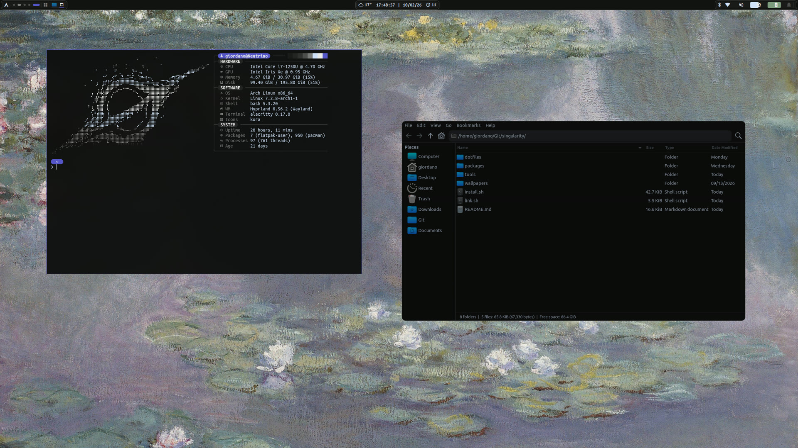

# Singularity

Arch + Hyprland (Lua config) + a Quickshell (QML) shell, themed as one system.
Turns a fresh Arch **Minimal** install into a finished desktop.



## Install

Needs Arch with `sudo`, systemd-boot or GRUB, and a network connection. Run it as
your user, not root.

```bash
sudo pacman -S --needed git
git clone https://github.com/unihermes/singularity.git ~/singularity
cd ~/singularity && ./install.sh
```

Keep the clone: the configs are symlinked from it. Reboot and pick **Hyprland** in the
greeter. Every step is idempotent, so rerunning is safe.

- `./install.sh desktop|laptop|auto` picks the profile (first interactive run asks).
  It is saved in `~/.local/state/singularity/machine`. Profiles are in
  `dotfiles/singularity/.config/singularity/profiles/`; hardware-specific packages and
  fixes install only where the hardware is found (`scripts/hardware.sh`).
- `./install.sh --plan [profile]` previews the selection without changing anything.
- `./link.sh` links the dotfiles only (no packages, services or sudo).
- `./update.sh` pulls, relinks and installs newly listed packages.
- Gaming fixes and tweaks for the desktop, with what to redo by hand: `GAMING.md`.
- Packages: `packages/pacman.txt`, `aur.txt`, `desktop.txt`, `laptop.txt`,
  `hardware/<capability>.txt`. Root-owned files: `system/`.

## Use

| Keys | Opens |
|---|---|
| `SUPER + ,` | Settings |
| `CTRL + SPACE` | Launcher |
| `SUPER + Return` | Terminal |
| `SUPER + K` | Keybinds (editable) |
| `SUPER + L` | Lock |
| `SUPER + SHIFT + E` | Power menu |
| `Print` | Screenshot |

The Arch logo on the bar opens the Control Centre; each module opens a flyout.

## Your settings

The repo is the stock setup; changes made on a machine never show up in `git status`.

- Shell state lives in `~/.local/state/singularity/` (delete it to reset).
- Files Settings rewrites (`binds.lua`, `hypridle.conf`, `hyprlock.conf`, terminal
  configs, `.bash_aliases`) are local copies `link.sh` seeds from
  `dotfiles/singularity/.config/singularity/*.defaults.*`. Delete one and run
  `./link.sh` to go back to stock.
- Your own Hyprland overrides go in `~/.local/state/singularity/custom.lua` (run last),
  shell additions in `~/.bashrc.local`.
- Per-monitor fixes go in `~/.local/state/singularity/display-fixes.lua`.
- To keep the greeter off a second monitor, add `video=<connector>:d` to the kernel
  command line and rerun `install.sh`.
- Codex notifications: set `notify = ["python3", "<home>/.config/singularity/codex-notify.py"]`
  in `~/.codex/config.toml`.

## Development

Start with `CLAUDE.md` (architecture, checks, conventions) and
`python3 tools/context.py [path]` for a compact source map. Configs are symlinks into
the repo, and saving a QML file reloads the shell. `link.sh` installs the pre-commit
hook that runs the checks in `tools/`.

## Troubleshooting

- **No greeter:** check `ly@tty2.service` is enabled, nothing else owns
  `display-manager.service`, and the default target is `graphical.target`.
- **Back at the greeter after login:** Hyprland exited. From a TTY (`CTRL+ALT+F3`) run
  `Hyprland`, then `hyprctl configerrors`.
- **No bar:** run `quickshell` in a terminal to see the QML error.
- **Boot menu:** hidden; hold `Space` at the firmware logo. `BOOT_VERBOSE=1 ./install.sh`
  shows boot messages.
- **Anything else:** run `diagnose`, or open System → Health.
